  

### 👨‍💻 About Me

- 🎓 Computer Science student at Holy Angel University.
- 🤖 Currently learning Python, AI, and software development.
- 🛠️ Building practical projects and strengthening my programming fundamentals.
- ♟️ Outside coding, I enjoy chess, gaming, and fitness.

### 🛠️ Languages & Tools

<table>
  <tr>
    <td align="center" width="100">
       Python
    </td>
    <td align="center" width="100">
       C
    </td>
    <td align="center" width="100">
       C++
    </td>
    <td align="center" width="100">
       Java
    </td>
    <td align="center" width="100">
       C#
    </td>
    <td align="center" width="100">
       Dart
    </td>
  </tr>
  <tr>
    <td align="center">
       HTML5
    </td>
    <td align="center">
       CSS3
    </td>
    <td align="center">
       JavaScript
    </td>
    <td align="center">
       TypeScript
    </td>
    <td align="center">
       PHP
    </td>
    <td align="center">
       NumPy
    </td>
  </tr>
  <tr>
    <td align="center">
       Pandas
    </td>
    <td align="center">
       React
    </td>
    <td align="center">
       Node.js
    </td>
    <td align="center">
       Flutter
    </td>
    <td align="center">
       MySQL
    </td>
    <td align="center">
       MongoDB
    </td>
  </tr>
  <tr>
    <td align="center">
       Git
    </td>
    <td align="center">
       GitHub
    </td>
    <td align="center">
       Linux
    </td>
    <td align="center">
       Docker
    </td>
    <td align="center">
       Figma
    </td>
    <td align="center">
       Godot
    </td>
  </tr>
</table>

### 👾 My Contributions

  <picture>
    <source media="(prefers-color-scheme: dark)" srcset="https://raw.githubusercontent.com/Simpledog1/Simpledog1/pacman-output/pacman-contribution-graph-dark.svg?game=pacman">
    <source media="(prefers-color-scheme: light)" srcset="https://raw.githubusercontent.com/Simpledog1/Simpledog1/pacman-output/pacman-contribution-graph.svg?game=pacman">
    
  </picture>

